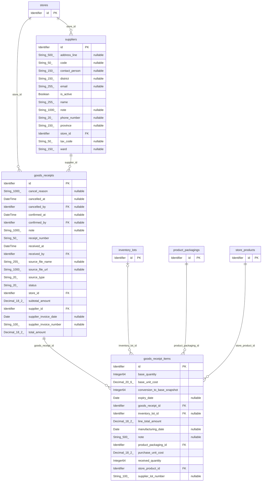
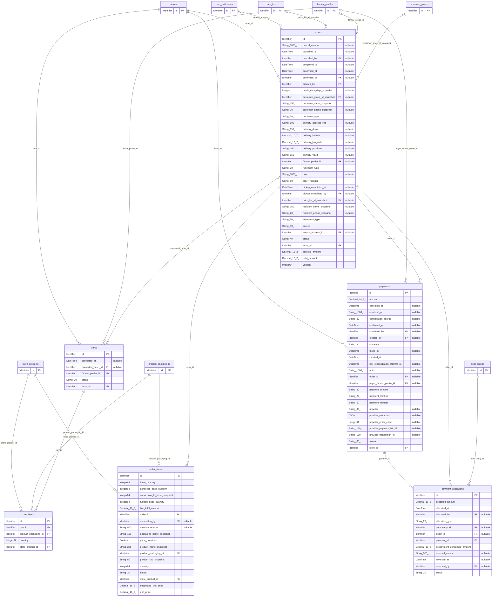
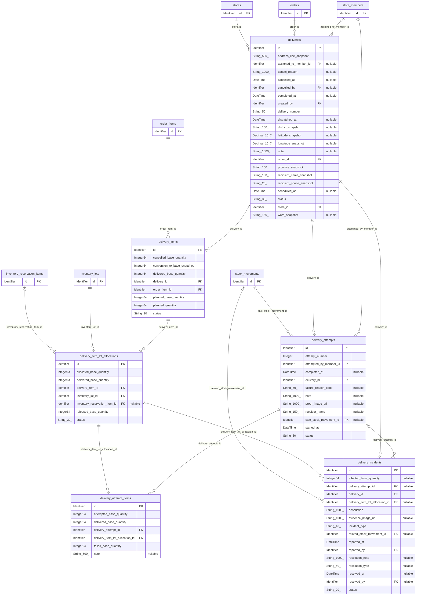
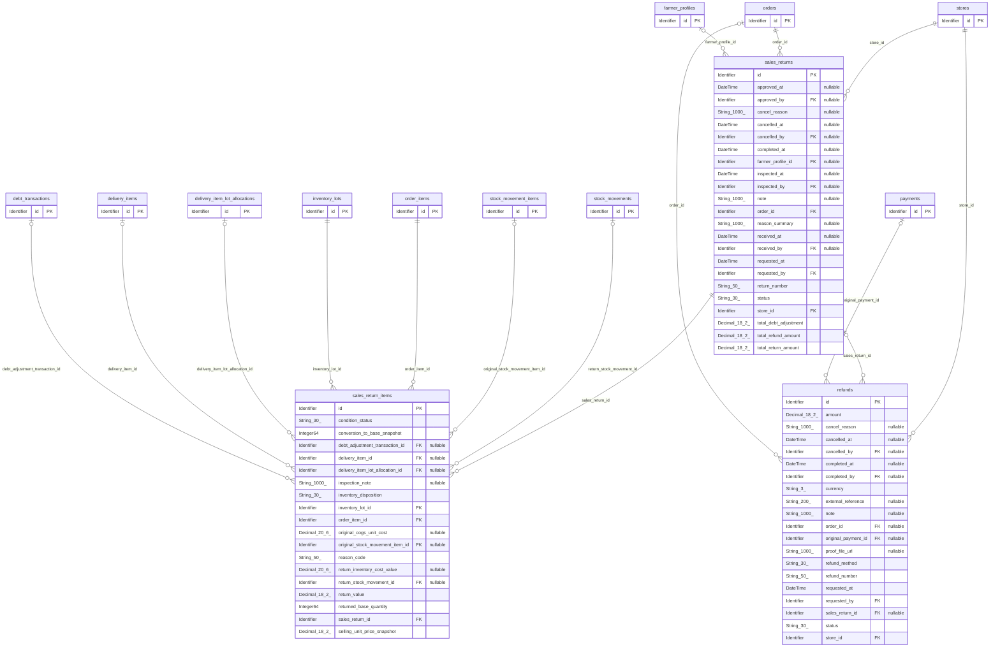

# AgriSage — Logical Data Model (Mermaid)

Ngày đối chiếu: **26/10/2026**. Phạm vi: **74 thực thể** trong thiết kế và migration snapshot local.

Theo [FPT IS — Các cấp độ của mô hình dữ liệu](https://fpt-is.com/goc-nhin-so/data-modeling-la-gi/), logical data model làm rõ thực thể, thuộc tính và quan hệ, độc lập với yêu cầu triển khai kỹ thuật. Bản này dùng ERD Mermaid, kiểu dữ liệu logic, khóa định danh/tham chiếu và cardinality; lược DDL, cấu hình index, default SQL và thông tin lưu trữ PostgreSQL.

## Phạm vi và nguồn

- [DATABASE_DESIGN.md](../../reference/DATABASE_DESIGN.md), bao gồm các bổ sung §35 và §36; [AUTH_OPERATIONS_SCHEMA.md](../../reference/AUTH_OPERATIONS_SCHEMA.md).
- Bộ Mermaid theo nhóm đã có và `model.json` ngày 20/10/2026; danh sách 74 thực thể, 1.079 thuộc tính và nullability đã được đối chiếu lại với migration snapshot hiện tại.
- InitialCreate có 67 bảng. Bốn thực thể mở rộng là AuthSession, RefreshToken, AuthChallenge, NotificationOutbox; ba thực thể phân quyền là Permission, RolePermission, StoreMemberPermission. Tổng hiện tại là 74.
- Bản này cập nhật `store_member_permissions.is_granted` thành nullable theo thiết kế §36.3, Domain và migration `PermissionOverrideInheritance`: true = Allow, false = Deny, NULL = kế thừa Role.
- Đây là mô hình của mã nguồn local; không xác nhận trạng thái database live.

## Quy ước đọc

- Tên thực thể giữ theo project để dễ tra cứu. `Identifier`, `String_n_`, `Integer64`, `Decimal_p_s_`, `Date`, `DateTime`, `Boolean`, `JSON` là các kiểu logical. Ví dụ `String_150_` là chuỗi tối đa 150 ký tự; `Decimal_18_2_` là số thập phân 18 chữ số, 2 chữ số sau dấu phẩy.
- `PK`: định danh chính; `FK`: thuộc tính tham chiếu; `UQ`: duy nhất không điều kiện trên thuộc tính. Khóa ghép và duy nhất có điều kiện không được rút thành UQ đơn.
- `"nullable"`: thuộc tính tùy chọn. Thuộc tính không có ghi chú này là bắt buộc.
- `A ||--o{ B`: mỗi B thuộc đúng một A; A có 0..N B. `A |o--o{ B`: B có thể không tham chiếu A. `A ||--o| B`: mỗi B thuộc một A; A có tối đa một B.
- Cardinality mô tả bản ghi được lưu, gồm trạng thái nháp và lịch sử. Một chứng từ nháp có thể chưa có dòng chi tiết.
- Thực thể chỉ có `id` trong sơ đồ nhóm là tham chiếu sang nhóm khác; thuộc tính của nó nằm tại nhóm sở hữu. File tổng thể hợp nhất mỗi thực thể thành một định nghĩa.
- Các sơ đồ lược trường audit dùng chung `created_at`, `updated_at`, `deleted_at`, `deleted_by` và phần lớn đường quan hệ ghi nhận tác nhân đến User để dễ đọc. Bản tổng thể cũng áp dụng phạm vi lược này, không liệt kê toàn bộ FK.
- `reference_type/reference_id` hoặc `entity_type/entity_id` là tham chiếu ngữ nghĩa đa hình; không tự biểu diễn chúng thành FK được ràng buộc.
- Unique có điều kiện hoặc khóa ghép cần đọc cùng ràng buộc nghiệp vụ; không suy thành 1–1 toàn cục. Chi tiết đầy đủ nằm trong thiết kế nguồn.

## Các quy tắc nghiệp vụ đi cùng mô hình

- StoreProduct nối Store với Product; InventoryLot thuộc StoreProduct. Số lượng tồn dùng đơn vị cơ sở; ProductPackaging mô tả quy đổi đóng gói.
- Thay đổi tồn vật lý phải có StockMovement và StockMovementItem. DeliveryItemLotAllocation ghi lô thực tế; FEFO gợi ý, nhân viên xác nhận lô.
- PaymentAllocation phân bổ thanh toán vào Order hoặc DebtEntry theo loại phân bổ; hai đích có điều kiện loại trừ. Liên kết Payment–Order không thay thế phân bổ tiền.
- Công nợ phát sinh cho giá trị chưa thanh toán sau fulfillment thành công; thay đổi công nợ phải có DebtTransaction. Credit exposure gồm dư nợ và credit reservations đang hoạt động; walk-in không có tín dụng/công nợ cá nhân.
- SalesReturnItem có đúng một nguồn: DeliveryItemLotAllocation hoặc StockMovementItem gốc. Từng liên kết là nullable nhưng có điều kiện XOR. Refund có thể hoàn tiền đơn hủy nên không bắt buộc có SalesReturn.
- AIInference lưu kết quả máy; AgentReview lưu quyết định Human Review. RecommendationItem cần duyệt hợp lệ; quyền reviewer không phải một primary role riêng.
- Không bán hoặc giữ lô hết hạn/bị chặn/cách ly. Bản ghi đã xác nhận không bị sửa âm thầm; xóa nghiệp vụ là soft-delete, hủy hoặc đảo.

## Mermaid tổng thể

[File Mermaid tổng thể — 74 thực thể](agrisage-logical-model-2026-10-26.mmd). Sơ đồ lớn; các phần bên dưới phù hợp để đọc theo nghiệp vụ và dán riêng vào Mermaid.

## 1. Tài khoản, xác thực và cửa hàng

```mermaid
erDiagram
    auth_challenges {
        Identifier id PK
        String_20_ channel
        DateTime consumed_at "nullable"
        String_255_ destination
        DateTime expires_at
        Integer failed_attempts
        String_30_ purpose
        Integer64 security_version
        String_64_ token_hash
        Identifier user_id FK
    }
    auth_sessions {
        Identifier id PK
        DateTime expires_at
        DateTime last_used_at
        String_100_ revocation_reason "nullable"
        DateTime revoked_at "nullable"
        Integer64 security_version
        Identifier user_id FK
    }
    permissions {
        Identifier id PK
        String_120_ code UQ
        Boolean is_active
        Boolean is_delegable
        String_50_ module
        String_150_ name
    }
    refresh_tokens {
        Identifier id PK
        DateTime consumed_at "nullable"
        DateTime expires_at
        Identifier session_id FK
        String_64_ token_hash UQ
    }
    role_permissions {
        Identifier id PK
        Boolean is_granted
        Identifier permission_id FK
        Identifier role_id FK
    }
    roles {
        Identifier id PK
        String_30_ code
        String_500_ description "nullable"
        Boolean is_active
        String_100_ name
        Integer64 version
    }
    store_member_permissions {
        Identifier id PK
        Boolean is_granted "nullable"
        Identifier permission_id FK
        Identifier store_member_id FK
    }
    store_members {
        Identifier id PK
        Boolean can_review_ai
        String_50_ employee_code "nullable"
        Date joined_at "nullable"
        Date left_at "nullable"
        String_20_ status
        Identifier store_id FK
        Identifier user_id FK
        Integer64 version
    }
    stores {
        Identifier id PK
        String_500_ address_line
        String_30_ code UQ
        String_150_ district "nullable"
        String_255_ email "nullable"
        String_200_ name
        String_20_ phone_number "nullable"
        String_150_ province
        String_20_ status
        String_50_ tax_code "nullable"
        String_150_ ward "nullable"
    }
    user_addresses {
        Identifier id PK
        String_500_ address_line
        String_20_ address_type
        String_150_ district "nullable"
        Boolean is_default
        Decimal_10_7_ latitude "nullable"
        Decimal_10_7_ longitude "nullable"
        String_150_ province
        String_150_ recipient_name
        String_20_ recipient_phone
        Identifier user_id FK
        String_150_ ward "nullable"
    }
    users {
        Identifier id PK
        String_1000_ avatar_url "nullable"
        String_255_ email "nullable"
        Boolean email_verified
        String_150_ full_name
        DateTime last_login_at "nullable"
        String_500_ password_hash
        String_20_ phone_number "nullable"
        Boolean phone_verified
        Identifier role_id FK
        Integer64 security_version
        String_30_ status
    }
    users ||--o{ auth_challenges : "user_id"
    users ||--o{ auth_sessions : "user_id"
    auth_sessions ||--o{ refresh_tokens : "session_id"
    permissions ||--o{ role_permissions : "permission_id"
    roles ||--o{ role_permissions : "role_id"
    permissions ||--o{ store_member_permissions : "permission_id"
    store_members ||--o{ store_member_permissions : "store_member_id"
    stores ||--o{ store_members : "store_id"
    users ||--o{ store_members : "user_id"
    users ||--o{ user_addresses : "user_id"
    roles ||--o{ users : "role_id"
```

## 2. Khách hàng và bảng giá

```mermaid
erDiagram
    credit_tiers {
        Identifier id PK
    }
    customer_group_assignments {
        Identifier id PK
        Identifier assigned_by FK
        Identifier customer_group_id FK
        DateTime effective_from
        DateTime effective_to "nullable"
        Identifier farmer_profile_id FK
        String_500_ reason "nullable"
    }
    customer_group_price_lists {
        Identifier id PK
        Identifier assigned_by FK
        Identifier customer_group_id FK
        DateTime effective_from
        DateTime effective_to "nullable"
        Identifier price_list_id FK
    }
    customer_groups {
        Identifier id PK
        String_30_ code
        Identifier default_credit_tier_id FK "nullable"
        String_500_ description "nullable"
        Boolean is_active
        Boolean is_default
        String_100_ name
        Integer priority
        Identifier store_id FK
    }
    farmer_profiles {
        Identifier id PK
        Date date_of_birth "nullable"
        String_20_ gender "nullable"
        String_1000_ notes "nullable"
        Identifier user_id FK,UQ
    }
    price_list_items {
        Identifier id PK
        Identifier price_list_id FK
        Identifier product_packaging_id FK
        Decimal_18_2_ selling_price
        Identifier store_product_id FK
    }
    price_lists {
        Identifier id PK
        String_50_ code
        String_500_ description "nullable"
        DateTime effective_from
        DateTime effective_to "nullable"
        Boolean is_walk_in_default
        String_150_ name
        String_20_ status
        Identifier store_id FK
    }
    product_packagings {
        Identifier id PK
    }
    store_products {
        Identifier id PK
    }
    stores {
        Identifier id PK
    }
    users {
        Identifier id PK
    }
    customer_groups ||--o{ customer_group_assignments : "customer_group_id"
    farmer_profiles ||--o{ customer_group_assignments : "farmer_profile_id"
    customer_groups ||--o{ customer_group_price_lists : "customer_group_id"
    price_lists ||--o{ customer_group_price_lists : "price_list_id"
    credit_tiers |o--o{ customer_groups : "default_credit_tier_id"
    stores ||--o{ customer_groups : "store_id"
    users ||--o| farmer_profiles : "user_id"
    price_lists ||--o{ price_list_items : "price_list_id"
    product_packagings ||--o{ price_list_items : "product_packaging_id"
    store_products ||--o{ price_list_items : "store_product_id"
    stores ||--o{ price_lists : "store_id"
```

## 3. Danh mục sản phẩm

```mermaid
erDiagram
    active_ingredients {
        Identifier id PK
        String_50_ code "nullable"
        String description "nullable"
        Boolean is_active
        String_200_ name
    }
    brands {
        Identifier id PK
        String_50_ code "nullable"
        String_500_ description "nullable"
        Boolean is_active
        String_1000_ logo_url "nullable"
        String_150_ name
    }
    categories {
        Identifier id PK
        String_50_ code
        String_500_ description "nullable"
        Integer display_order
        Boolean is_active
        String_150_ name
        Identifier parent_id FK "nullable"
    }
    farmer_profiles {
        Identifier id PK
    }
    order_items {
        Identifier id PK
    }
    product_active_ingredients {
        Identifier id PK
        Identifier active_ingredient_id FK
        String_100_ concentration "nullable"
        String_500_ note "nullable"
        Identifier product_id FK
    }
    product_packagings {
        Identifier id PK
        String_100_ barcode "nullable"
        Integer64 conversion_to_base
        Boolean is_base_unit
        Boolean is_purchase_unit
        Boolean is_sale_unit
        String_150_ packaging_name "nullable"
        Identifier product_id FK
        String_20_ status
        Identifier unit_id FK
    }
    product_reviews {
        Identifier id PK
        String comment "nullable"
        Identifier farmer_profile_id FK
        Identifier order_item_id FK
        Integer rating
        String_20_ status
        Identifier store_product_id FK
    }
    products {
        Identifier id PK
        Identifier brand_id FK "nullable"
        Identifier category_id FK
        String description "nullable"
        String_1000_ image_url "nullable"
        String_255_ name
        Boolean requires_expiry_date
        Boolean requires_lot_tracking
        String_50_ sku UQ
        String_20_ status
        String usage_instructions "nullable"
    }
    store_products {
        Identifier id PK
        Boolean is_active
        Boolean is_sellable
        Integer64 min_stock_level_base "nullable"
        Identifier product_id FK
        Identifier store_id FK
        String_50_ store_sku "nullable"
    }
    stores {
        Identifier id PK
    }
    units {
        Identifier id PK
        String_30_ code UQ
        Boolean is_active
        String_100_ name
        String_20_ symbol "nullable"
    }
    categories |o--o{ categories : "parent_id"
    active_ingredients ||--o{ product_active_ingredients : "active_ingredient_id"
    products ||--o{ product_active_ingredients : "product_id"
    products ||--o{ product_packagings : "product_id"
    units ||--o{ product_packagings : "unit_id"
    farmer_profiles ||--o{ product_reviews : "farmer_profile_id"
    order_items ||--o{ product_reviews : "order_item_id"
    store_products ||--o{ product_reviews : "store_product_id"
    brands |o--o{ products : "brand_id"
    categories ||--o{ products : "category_id"
    products ||--o{ store_products : "product_id"
    stores ||--o{ store_products : "store_id"
```

## 4. Nhà cung cấp và nhập hàng



## 5. Tồn kho và đặt giữ hàng

```mermaid
erDiagram
    deliveries {
        Identifier id PK
    }
    goods_receipts {
        Identifier id PK
    }
    inventory_lot_balances {
        Identifier id PK
        Identifier inventory_lot_id FK,UQ
        Integer64 quantity_on_hand
        Integer64 quantity_reserved
        Decimal_20_6_ total_cost_value
        Integer64 version
    }
    inventory_lots {
        Identifier id PK
        Date expiry_date "nullable"
        String_100_ lot_number "nullable"
        Date manufacturing_date "nullable"
        String_30_ status
        Identifier store_product_id FK
    }
    inventory_reservation_items {
        Identifier id PK
        Integer64 base_quantity_consumed
        Integer64 base_quantity_released
        Integer64 base_quantity_reserved
        Identifier inventory_lot_id FK
        Identifier inventory_reservation_id FK
        Identifier order_item_id FK
    }
    inventory_reservations {
        Identifier id PK
        Identifier order_id FK
        String_500_ release_reason "nullable"
        DateTime released_at "nullable"
        Identifier released_by FK "nullable"
        DateTime reserved_at
        Identifier reserved_by FK
        String_30_ status
        Identifier store_id FK
    }
    order_items {
        Identifier id PK
    }
    orders {
        Identifier id PK
    }
    sales_returns {
        Identifier id PK
    }
    stock_movement_items {
        Identifier id PK
        Identifier inventory_lot_id FK
        String_500_ note "nullable"
        Integer64 quantity_delta_base
        Integer64 quantity_on_hand_after "nullable"
        Identifier stock_movement_id FK
        Decimal_20_6_ total_cost_snapshot
        Decimal_20_6_ total_cost_value_after "nullable"
        Decimal_20_6_ unit_cost_snapshot
    }
    stock_movements {
        Identifier id PK
        Identifier created_by FK
        Identifier delivery_id FK "nullable"
        Identifier goods_receipt_id FK "nullable"
        String_50_ movement_number
        String_30_ movement_type
        DateTime occurred_at
        Identifier order_id FK "nullable"
        DateTime posted_at "nullable"
        Identifier posted_by FK "nullable"
        String_1000_ reason "nullable"
        String_50_ reason_code "nullable"
        Identifier reversal_of_movement_id FK "nullable"
        Identifier sales_return_id FK "nullable"
        String_20_ status
        Identifier stocktake_id FK "nullable"
        Identifier store_id FK
    }
    stocktake_items {
        Identifier id PK
        DateTime counted_at "nullable"
        Identifier counted_by FK "nullable"
        Integer64 counted_quantity "nullable"
        Decimal_20_6_ difference_cost_value "nullable"
        Integer64 difference_quantity "nullable"
        Identifier inventory_lot_id FK
        String_500_ note "nullable"
        String_50_ reason_code "nullable"
        DateTime snapshot_at
        Identifier stocktake_id FK
        Integer64 system_quantity_snapshot
        Decimal_20_6_ unit_cost_snapshot "nullable"
    }
    stocktakes {
        Identifier id PK
        DateTime completed_at "nullable"
        Identifier completed_by FK "nullable"
        Identifier created_by FK
        String_1000_ note "nullable"
        DateTime started_at "nullable"
        Identifier started_by FK "nullable"
        String_30_ status
        String_50_ stocktake_number
        Identifier store_id FK
    }
    store_products {
        Identifier id PK
    }
    stores {
        Identifier id PK
    }
    inventory_lots ||--o| inventory_lot_balances : "inventory_lot_id"
    store_products ||--o{ inventory_lots : "store_product_id"
    inventory_lots ||--o{ inventory_reservation_items : "inventory_lot_id"
    inventory_reservations ||--o{ inventory_reservation_items : "inventory_reservation_id"
    order_items ||--o{ inventory_reservation_items : "order_item_id"
    orders ||--o{ inventory_reservations : "order_id"
    stores ||--o{ inventory_reservations : "store_id"
    inventory_lots ||--o{ stock_movement_items : "inventory_lot_id"
    stock_movements ||--o{ stock_movement_items : "stock_movement_id"
    deliveries |o--o{ stock_movements : "delivery_id"
    goods_receipts |o--o{ stock_movements : "goods_receipt_id"
    orders |o--o{ stock_movements : "order_id"
    stock_movements |o--o{ stock_movements : "reversal_of_movement_id"
    sales_returns |o--o{ stock_movements : "sales_return_id"
    stocktakes |o--o{ stock_movements : "stocktake_id"
    stores ||--o{ stock_movements : "store_id"
    inventory_lots ||--o{ stocktake_items : "inventory_lot_id"
    stocktakes ||--o{ stocktake_items : "stocktake_id"
    stores ||--o{ stocktakes : "store_id"
```

## 6. Giỏ hàng, đơn hàng và thanh toán



## 7. Giao hàng và truy vết lô



## 8. Tín dụng và công nợ

```mermaid
erDiagram
    credit_limit_histories {
        Identifier id PK
        DateTime changed_at
        Identifier changed_by FK
        Identifier farmer_credit_profile_id FK
        Decimal_18_2_ new_credit_limit
        Identifier new_credit_tier_id FK "nullable"
        Decimal_18_2_ old_credit_limit
        Identifier old_credit_tier_id FK "nullable"
        String_1000_ reason
    }
    credit_reservations {
        Identifier id PK
        Decimal_18_2_ amount_consumed
        Decimal_18_2_ amount_released
        Decimal_18_2_ amount_reserved
        Identifier farmer_credit_profile_id FK
        Identifier order_id FK
        String_500_ release_reason "nullable"
        DateTime released_at "nullable"
        Identifier released_by FK "nullable"
        DateTime reserved_at
        Identifier reserved_by FK
        String_30_ status
        Identifier store_id FK
    }
    credit_tiers {
        Identifier id PK
        String_30_ code
        Decimal_18_2_ default_credit_limit
        Integer default_payment_term_days
        String_500_ description "nullable"
        Boolean is_active
        String_100_ name
        Identifier store_id FK
    }
    debt_accounts {
        Identifier id PK
        Decimal_18_2_ current_balance
        Identifier farmer_profile_id FK
        DateTime last_transaction_at "nullable"
        String_20_ status
        Identifier store_id FK
        Integer64 version
    }
    debt_entries {
        Identifier id PK
        Identifier created_by FK
        Identifier debt_account_id FK
        Identifier delivery_attempt_id FK "nullable"
        Identifier delivery_id FK "nullable"
        Date due_date
        String_50_ entry_number UQ
        Decimal_18_2_ fulfillment_value
        Identifier order_id FK "nullable"
        Decimal_18_2_ original_amount
        Decimal_18_2_ outstanding_amount
        Decimal_18_2_ prepayment_applied_amount
        Identifier source_stock_movement_id FK "nullable"
        String_30_ source_type
        String_30_ status
    }
    debt_entry_actions {
        Identifier id PK
        String_30_ action_type
        Decimal_18_2_ adjustment_amount "nullable"
        Identifier created_by FK
        Identifier debt_entry_id FK
        Date new_due_date "nullable"
        Date old_due_date "nullable"
        Decimal_18_2_ previous_outstanding_amount "nullable"
        String_1000_ reason
        Decimal_18_2_ resulting_outstanding_amount "nullable"
    }
    debt_transactions {
        Identifier id PK
        Decimal_18_2_ amount_delta
        Decimal_18_2_ balance_after
        Identifier created_by FK "nullable"
        Identifier debt_account_id FK
        Identifier debt_entry_action_id FK "nullable"
        Identifier debt_entry_id FK "nullable"
        String_1000_ note "nullable"
        DateTime occurred_at
        Identifier payment_allocation_id FK "nullable"
        Identifier reversal_of_transaction_id FK "nullable"
        Identifier sales_return_id FK "nullable"
        String_20_ status
        String_30_ transaction_type
    }
    deliveries {
        Identifier id PK
    }
    delivery_attempts {
        Identifier id PK
    }
    farmer_credit_profiles {
        Identifier id PK
        DateTime approved_at
        Identifier approved_by FK
        Decimal_18_2_ credit_limit
        Identifier credit_tier_id FK "nullable"
        Identifier farmer_profile_id FK
        String_1000_ note "nullable"
        String_20_ status
        Identifier store_id FK
        Integer64 version
    }
    farmer_profiles {
        Identifier id PK
    }
    orders {
        Identifier id PK
    }
    payment_allocations {
        Identifier id PK
    }
    sales_returns {
        Identifier id PK
    }
    stock_movements {
        Identifier id PK
    }
    stores {
        Identifier id PK
    }
    farmer_credit_profiles ||--o{ credit_limit_histories : "farmer_credit_profile_id"
    credit_tiers |o--o{ credit_limit_histories : "new_credit_tier_id"
    credit_tiers |o--o{ credit_limit_histories : "old_credit_tier_id"
    farmer_credit_profiles ||--o{ credit_reservations : "farmer_credit_profile_id"
    orders ||--o{ credit_reservations : "order_id"
    stores ||--o{ credit_reservations : "store_id"
    stores ||--o{ credit_tiers : "store_id"
    farmer_profiles ||--o{ debt_accounts : "farmer_profile_id"
    stores ||--o{ debt_accounts : "store_id"
    debt_accounts ||--o{ debt_entries : "debt_account_id"
    delivery_attempts |o--o{ debt_entries : "delivery_attempt_id"
    deliveries |o--o{ debt_entries : "delivery_id"
    orders |o--o{ debt_entries : "order_id"
    stock_movements |o--o{ debt_entries : "source_stock_movement_id"
    debt_entries ||--o{ debt_entry_actions : "debt_entry_id"
    debt_accounts ||--o{ debt_transactions : "debt_account_id"
    debt_entry_actions |o--o{ debt_transactions : "debt_entry_action_id"
    debt_entries |o--o{ debt_transactions : "debt_entry_id"
    payment_allocations |o--o{ debt_transactions : "payment_allocation_id"
    debt_transactions |o--o{ debt_transactions : "reversal_of_transaction_id"
    sales_returns |o--o{ debt_transactions : "sales_return_id"
    credit_tiers |o--o{ farmer_credit_profiles : "credit_tier_id"
    farmer_profiles ||--o{ farmer_credit_profiles : "farmer_profile_id"
    stores ||--o{ farmer_credit_profiles : "store_id"
```

## 9. Trả hàng và hoàn tiền



## 10. Chẩn đoán AI và Human Review

```mermaid
erDiagram
    active_ingredients {
        Identifier id PK
    }
    agent_reviews {
        Identifier id PK
        Identifier ai_disease_id_snapshot FK "nullable"
        String_2000_ comment "nullable"
        String_30_ decision
        Identifier diagnosis_case_id FK
        Identifier final_disease_id FK "nullable"
        Boolean is_current
        Identifier primary_ai_inference_id FK "nullable"
        DateTime reviewed_at
        Identifier reviewer_member_id FK
        DateTime superseded_at "nullable"
        Identifier superseded_by_review_id FK "nullable"
    }
    ai_inferences {
        Identifier id PK
        Identifier ai_model_id FK
        Identifier ai_policy_config_id FK
        Decimal_7_6_ confidence
        Identifier diagnosis_case_id FK
        Identifier diagnosis_image_id FK
        Integer inference_duration_ms "nullable"
        DateTime inferred_at
        Boolean passed_policy
        String_100_ predicted_class_label
        Identifier predicted_disease_id FK "nullable"
        JSON raw_output "nullable"
        String_20_ status
        JSON top_predictions "nullable"
    }
    ai_models {
        Identifier id PK
        String_100_ architecture "nullable"
        JSON class_labels
        Identifier created_by FK
        DateTime deployed_at "nullable"
        String_50_ framework
        Integer input_height "nullable"
        Integer input_width "nullable"
        JSON metrics "nullable"
        String_1000_ model_storage_url
        String_150_ name
        DateTime retired_at "nullable"
        String_30_ status
        String_50_ version
    }
    ai_policy_configs {
        Identifier id PK
        Identifier ai_model_id FK
        Identifier created_by FK
        DateTime effective_from
        DateTime effective_to "nullable"
        Decimal_5_4_ minimum_confidence
        Decimal_5_4_ minimum_margin "nullable"
        JSON parameters "nullable"
        Boolean requires_human_review
        String_20_ status
        Integer top_k
        String_50_ version
    }
    diagnosis_cases {
        Identifier id PK
        String_50_ case_number UQ
        DateTime completed_at "nullable"
        String_50_ crop_type
        String_1000_ farmer_note "nullable"
        Identifier farmer_profile_id FK
        Identifier final_disease_id FK "nullable"
        String_1000_ review_summary "nullable"
        String_30_ status
        DateTime submitted_at
    }
    diagnosis_images {
        Identifier id PK
        Identifier diagnosis_case_id FK
        String_255_ file_name "nullable"
        Integer64 file_size_bytes "nullable"
        Integer height "nullable"
        String_1500_ image_url
        Boolean is_primary
        String_100_ mime_type "nullable"
        String_1000_ storage_key
        DateTime uploaded_at
        Integer width "nullable"
    }
    disease_treatments {
        Identifier id PK
        Identifier active_ingredient_id FK "nullable"
        Identifier disease_id FK
        String instructions
        Boolean is_active
        String precautions "nullable"
        Integer priority
        String_255_ title
        String_30_ treatment_type
    }
    diseases {
        Identifier id PK
        String causes "nullable"
        String_50_ code UQ
        String_50_ crop_type
        String description "nullable"
        Boolean is_active
        Boolean is_healthy_class
        String_200_ name
        String prevention "nullable"
        String_255_ scientific_name "nullable"
        String symptoms "nullable"
    }
    farmer_profiles {
        Identifier id PK
    }
    recommendation_items {
        Identifier id PK
        Identifier agent_review_id FK
        DateTime approved_at
        Identifier approved_by FK
        Identifier diagnosis_case_id FK
        Identifier disease_treatment_id FK "nullable"
        Boolean is_active
        Integer rank_order
        String_1000_ reason "nullable"
        String_20_ recommendation_type
        Identifier store_product_id FK "nullable"
    }
    store_members {
        Identifier id PK
    }
    store_products {
        Identifier id PK
    }
    diseases |o--o{ agent_reviews : "ai_disease_id_snapshot"
    diagnosis_cases ||--o{ agent_reviews : "diagnosis_case_id"
    diseases |o--o{ agent_reviews : "final_disease_id"
    ai_inferences |o--o{ agent_reviews : "primary_ai_inference_id"
    store_members ||--o{ agent_reviews : "reviewer_member_id"
    agent_reviews |o--o{ agent_reviews : "superseded_by_review_id"
    ai_models ||--o{ ai_inferences : "ai_model_id"
    ai_policy_configs ||--o{ ai_inferences : "ai_policy_config_id"
    diagnosis_cases ||--o{ ai_inferences : "diagnosis_case_id"
    diagnosis_images ||--o{ ai_inferences : "diagnosis_image_id"
    diseases |o--o{ ai_inferences : "predicted_disease_id"
    ai_models ||--o{ ai_policy_configs : "ai_model_id"
    farmer_profiles ||--o{ diagnosis_cases : "farmer_profile_id"
    diseases |o--o{ diagnosis_cases : "final_disease_id"
    diagnosis_cases ||--o{ diagnosis_images : "diagnosis_case_id"
    active_ingredients |o--o{ disease_treatments : "active_ingredient_id"
    diseases ||--o{ disease_treatments : "disease_id"
    agent_reviews ||--o{ recommendation_items : "agent_review_id"
    diagnosis_cases ||--o{ recommendation_items : "diagnosis_case_id"
    disease_treatments |o--o{ recommendation_items : "disease_treatment_id"
    store_products |o--o{ recommendation_items : "store_product_id"
```

## 11. Nội dung, thông báo và nhật ký

```mermaid
erDiagram
    articles {
        Identifier id PK
        Identifier author_id FK
        String content
        DateTime published_at "nullable"
        String_255_ slug
        String_20_ status
        String_1000_ summary "nullable"
        String_1000_ thumbnail_url "nullable"
        String_255_ title
    }
    audit_logs {
        Identifier id PK
        String_100_ action
        Identifier actor_user_id FK "nullable"
        String_100_ correlation_id "nullable"
        Identifier entity_id "nullable"
        String_100_ entity_type
        String_64_ ip_address "nullable"
        JSON new_values "nullable"
        DateTime occurred_at
        JSON old_values "nullable"
        String_1000_ reason "nullable"
        Identifier store_id FK "nullable"
        String_1000_ user_agent "nullable"
    }
    contact_requests {
        Identifier id PK
        Identifier assigned_to FK "nullable"
        String_255_ contact_email "nullable"
        String_150_ contact_name
        String_20_ contact_phone "nullable"
        String message
        String_50_ request_number UQ
        String_2000_ resolution_note "nullable"
        DateTime resolved_at "nullable"
        String_20_ status
        String_255_ subject
        Identifier user_id FK "nullable"
    }
    notification_outbox {
        Identifier id PK
        Integer attempts
        Identifier audit_log_id FK,UQ
        DateTime available_at
        String_100_ last_error_code "nullable"
        DateTime processed_at "nullable"
    }
    notifications {
        Identifier id PK
        JSON data "nullable"
        String_200_ deduplication_key "nullable"
        String_2000_ message
        String_50_ notification_type
        DateTime read_at "nullable"
        String_20_ status
        String_255_ title
        Identifier user_id FK
    }
    stores {
        Identifier id PK
    }
    users {
        Identifier id PK
    }
    stores |o--o{ audit_logs : "store_id"
    users |o--o{ contact_requests : "user_id"
    audit_logs ||--o| notification_outbox : "audit_log_id"
    users ||--o{ notifications : "user_id"
```
