# AgriSage — Logical Data Model: bản trình bày gọn

Đã chỉnh theo góp ý giảm quan hệ gây rối. Phạm vi chi tiết vẫn là **74 thực thể**; số đường quan hệ hiển thị giảm từ **161 xuống 105**, lược **56 đường (35%)**. Không thay đổi database, entity, FK hay migration.

## Cách dùng trong báo cáo

- Dùng **sơ đồ đọc nhanh** để giới thiệu phạm vi: 23 thực thể chọn lọc, 29 quan hệ. Đây là một góc nhìn của logical model, không phải toàn bộ schema.
- Dùng **11 sơ đồ nghiệp vụ** bên dưới làm phần logical data model chi tiết. Mỗi thực thể xuất hiện đầy đủ ở đúng một nhóm; các khung chỉ có `id` là tham chiếu sang nhóm khác.
- File [Mermaid 74 thực thể](simplified/all-74-entities.mmd) phục vụ tra cứu tổng thể. Khi trình bày, dùng các nhóm bên dưới để tránh dồn toàn bộ mô hình lên một trang.

## Những điểm đã sửa

| Trước | Bản đã chỉnh |
|---|---|
| Nhiều đường về Store trên hầu hết giao dịch | Giữ Store–StoreMember và Store–StoreProduct; mô tả phạm vi Store dùng chung bằng chú thích |
| Các đường snapshot, địa chỉ gốc, lịch sử và đảo giao dịch cùng xuất hiện | Đưa vào bản đối chiếu; lược khỏi hình chính |
| Nhiều đường truy vết nối chéo qua các phân hệ | Chọn đường thể hiện cấu trúc nghiệp vụ chính; giữ các bảng nối và nguồn quan trọng |
| Quá nhiều thuộc tính kỹ thuật trong từng khung | Chỉ hiện định danh, FK được vẽ và thuộc tính nghiệp vụ tiêu biểu |
| Một hình chứa mọi chi tiết | Một hình đọc nhanh và 11 hình theo nghiệp vụ |

Các quan hệ được ẩn là **hợp lệ trong schema**; không có kết luận rằng chúng dư thừa trong database. Không áp dụng quy tắc máy móc “đã nối gián tiếp thì xóa nối trực tiếp”: các FK trực tiếp có thể mang ý nghĩa kiểm soát, lịch sử hoặc đối soát riêng.

## Quy ước và giới hạn

- `PK`: khóa chính; `FK`: thuộc tính tham chiếu; `UK`: thuộc tính duy nhất không điều kiện. `optional` nghĩa là có thể NULL.
- `||` = đúng một; `o|` = không hoặc một; `o{` = không hoặc nhiều. Ví dụ `A ||--o{ B`: mỗi B bắt buộc thuộc một A; A có thể chưa có B.
- Chỉ thể hiện thuộc tính và quan hệ được chọn cho góc nhìn này. Không có đường nối trên hình không có nghĩa là không có FK trong dữ liệu.
- Các bảng thuộc phạm vi cửa hàng vẫn có `store_id` theo thiết kế gốc. Việc lược đường Store không bỏ ràng buộc cửa hàng và không cho phép hard-code Store ID.
- Không vẽ thêm quan hệ suy diễn hoặc quan hệ N–N trực tiếp khi đã dùng thực thể liên kết để biểu diễn cùng một ý nghĩa.
- Giữ tên thực thể của project; dùng kiểu logic Identifier, String, Integer, Decimal, Boolean, Date và DateTime. Chi tiết độ dài, precision, nullability và FK không được chọn xem trong tài liệu nguồn.
- Logical model gồm thực thể, thuộc tính và quan hệ, độc lập chi tiết triển khai kỹ thuật theo [FPT IS](https://fpt-is.com/goc-nhin-so/data-modeling-la-gi/).

## Ràng buộc cần đọc cùng sơ đồ

- PaymentAllocation giữ cả hai đích Order và DebtEntry: chọn đích theo allocation type, không đồng thời phân bổ cùng một dòng cho cả hai. Payment có thể chưa có allocation, nên đường nối này không mô tả toàn bộ vòng đời thanh toán.
- GoodsReceiptItem có thể chưa gắn InventoryLot khi còn nháp. Tồn vật lý thay đổi qua StockMovement + StockMovementItem; liên kết tới chứng từ nguồn vẫn có trong bản chi tiết dù lược trên hình.
- SalesReturnItem giữ hai nguồn DeliveryItemLotAllocation và StockMovementItem gốc, với điều kiện **đúng một nguồn**. Không gom hai nguồn thành một quan hệ giả. Refund giữ cả Order, Payment và SalesReturn vì hoàn tiền có thể xuất phát từ đơn hủy.
- DebtTransaction vẫn là nhật ký biến động công nợ; chỉ tạo công nợ cho phần chưa thanh toán sau fulfillment thành công. Các FK tới Delivery/Attempt/StockMovement của DebtEntry được lược trên hình, vẫn có trong schema.
- AIInference → AgentReview → RecommendationItem giữ rõ kết quả máy, quyết định Human Review và khuyến nghị. Quyền duyệt thuộc StoreMember; không thêm role AI Reviewer. FK trực tiếp từ inference/recommendation về DiagnosisCase vẫn được lưu dù ẩn trên hình.
- Phân quyền thành viên: `is_granted = true` là Allow, `false` là Deny, `NULL` kế thừa Role.

## Sơ đồ đọc nhanh — góc nhìn chọn lọc

[Mã Mermaid riêng](simplified/00-overview.mmd).

```mermaid
erDiagram
    direction TB
    agent_reviews {
        Identifier id PK
        String decision
        Boolean is_current
    }
    debt_accounts {
        Identifier id PK
        Decimal current_balance
        String status
    }
    debt_entries {
        Identifier id PK
        String entry_number UK
        Decimal original_amount
    }
    deliveries {
        Identifier id PK
        String delivery_number
        String status
    }
    diagnosis_cases {
        Identifier id PK
        String case_number UK
        String crop_type
    }
    diseases {
        Identifier id PK
        String code UK
        String name
    }
    farmer_profiles {
        Identifier id PK
        Date date_of_birth "optional"
        String gender "optional"
    }
    goods_receipt_items {
        Identifier id PK
        Integer base_quantity
        Decimal base_unit_cost
    }
    goods_receipts {
        Identifier id PK
        String receipt_number
        DateTime received_at
    }
    inventory_lots {
        Identifier id PK
        String lot_number "optional"
        Date expiry_date "optional"
    }
    order_items {
        Identifier id PK
        Integer base_quantity
        Decimal unit_price
    }
    orders {
        Identifier id PK
        String order_number
        String customer_type
    }
    payment_allocations {
        Identifier id PK
        String allocation_type
        Decimal allocated_amount
    }
    payments {
        Identifier id PK
        String payment_number
        String payment_method
    }
    products {
        Identifier id PK
        String sku UK
        String name
    }
    recommendation_items {
        Identifier id PK
        String recommendation_type
        Integer rank_order
    }
    refunds {
        Identifier id PK
        String refund_number
        Decimal amount
    }
    sales_return_items {
        Identifier id PK
        Integer returned_base_quantity
        Decimal return_value
    }
    sales_returns {
        Identifier id PK
        String return_number
        Decimal total_return_amount
    }
    store_products {
        Identifier id PK
        String store_sku "optional"
        Boolean is_sellable
    }
    stores {
        Identifier id PK
        String code UK
        String name
    }
    suppliers {
        Identifier id PK
        String code "optional"
        String name
    }
    users {
        Identifier id PK
        String full_name
        String phone_number "optional"
    }
    agent_reviews ||--o{ recommendation_items : "agent_review_id"
    debt_accounts ||--o{ debt_entries : "debt_account_id"
    debt_entries |o--o{ payment_allocations : "debt_entry_id"
    diagnosis_cases ||--o{ agent_reviews : "diagnosis_case_id"
    diseases |o--o{ agent_reviews : "final_disease_id"
    farmer_profiles |o--o{ orders : "farmer_profile_id"
    farmer_profiles ||--o{ debt_accounts : "farmer_profile_id"
    farmer_profiles ||--o{ diagnosis_cases : "farmer_profile_id"
    goods_receipts ||--o{ goods_receipt_items : "goods_receipt_id"
    inventory_lots |o--o{ goods_receipt_items : "inventory_lot_id"
    order_items ||--o{ sales_return_items : "order_item_id"
    orders |o--o{ debt_entries : "order_id"
    orders |o--o{ payment_allocations : "order_id"
    orders |o--o{ refunds : "order_id"
    orders ||--o{ deliveries : "order_id"
    orders ||--o{ order_items : "order_id"
    orders ||--o{ sales_returns : "order_id"
    payments |o--o{ refunds : "original_payment_id"
    payments ||--o{ payment_allocations : "payment_id"
    products ||--o{ store_products : "product_id"
    sales_returns |o--o{ refunds : "sales_return_id"
    sales_returns ||--o{ sales_return_items : "sales_return_id"
    store_products |o--o{ recommendation_items : "store_product_id"
    store_products ||--o{ goods_receipt_items : "store_product_id"
    store_products ||--o{ inventory_lots : "store_product_id"
    store_products ||--o{ order_items : "store_product_id"
    stores ||--o{ store_products : "store_id"
    suppliers ||--o{ goods_receipts : "supplier_id"
    users ||--o| farmer_profiles : "user_id"
```

## Các sơ đồ nghiệp vụ

| Nhóm | Thực thể sở hữu | Quan hệ được vẽ | Mã Mermaid |
|---|---:|---:|---|
| Tài khoản, xác thực và cửa hàng | 11 | 11 | [01-identity-store.mmd](simplified/01-identity-store.mmd) |
| Khách hàng và bảng giá | 6 | 9 | [02-customers-pricing.mmd](simplified/02-customers-pricing.mmd) |
| Danh mục sản phẩm | 9 | 11 | [03-catalog.mmd](simplified/03-catalog.mmd) |
| Nhà cung cấp và nhập hàng | 3 | 5 | [04-receiving.mmd](simplified/04-receiving.mmd) |
| Tồn kho và đặt giữ hàng | 8 | 10 | [05-inventory.mmd](simplified/05-inventory.mmd) |
| Giỏ hàng, đơn hàng và thanh toán | 6 | 11 | [06-sales-payments.mmd](simplified/06-sales-payments.mmd) |
| Giao hàng và truy vết lô | 6 | 9 | [07-delivery.mmd](simplified/07-delivery.mmd) |
| Tín dụng và công nợ | 8 | 13 | [08-credit-debt.mmd](simplified/08-credit-debt.mmd) |
| Trả hàng và hoàn tiền | 3 | 8 | [09-returns.mmd](simplified/09-returns.mmd) |
| Chẩn đoán AI và Human Review | 9 | 15 | [10-ai-diagnosis.mmd](simplified/10-ai-diagnosis.mmd) |
| Nội dung và hệ thống | 5 | 3 | [11-content-system.mmd](simplified/11-content-system.mmd) |

## 1. Tài khoản, xác thực và cửa hàng

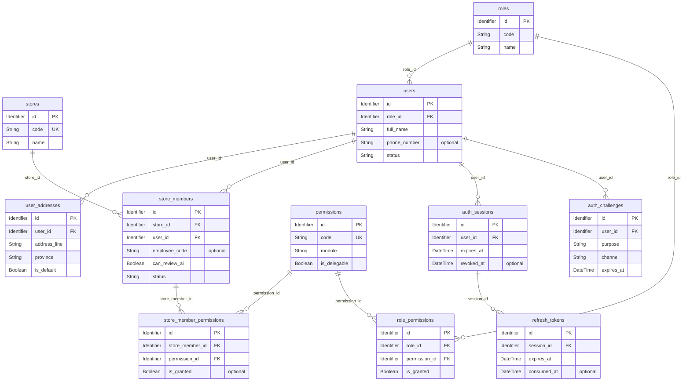

## 2. Khách hàng và bảng giá

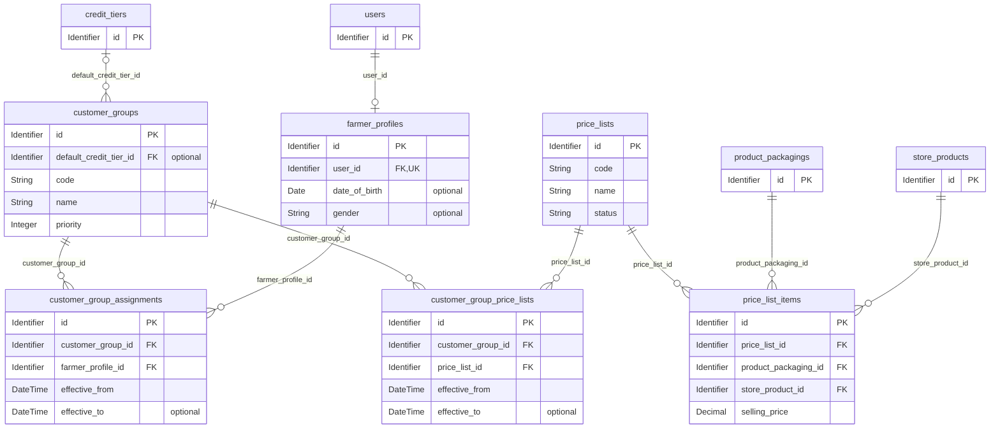

## 3. Danh mục sản phẩm

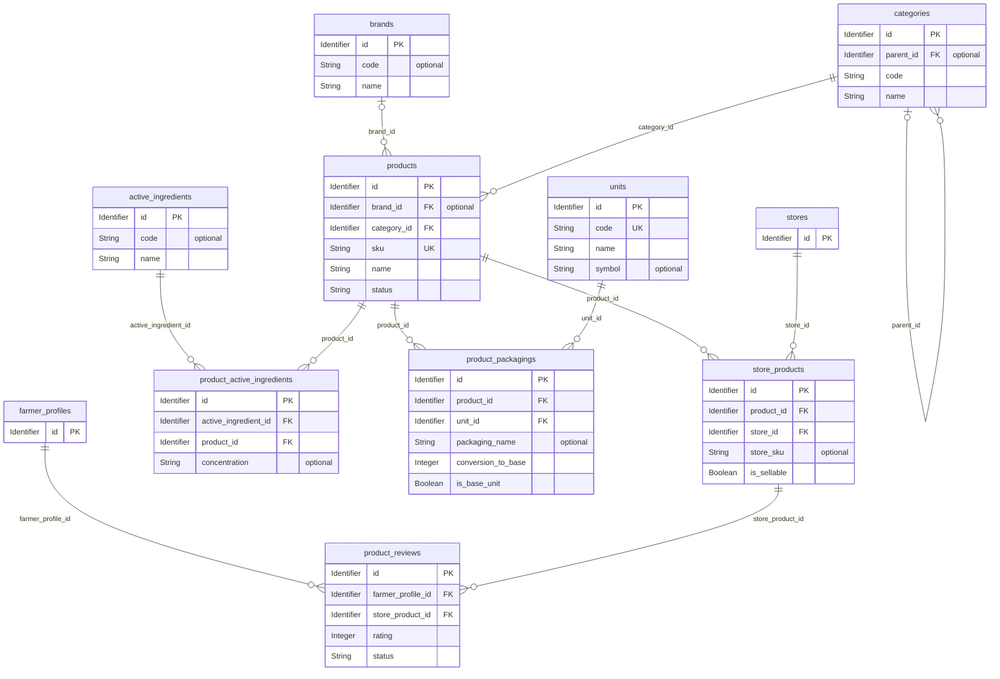

## 4. Nhà cung cấp và nhập hàng

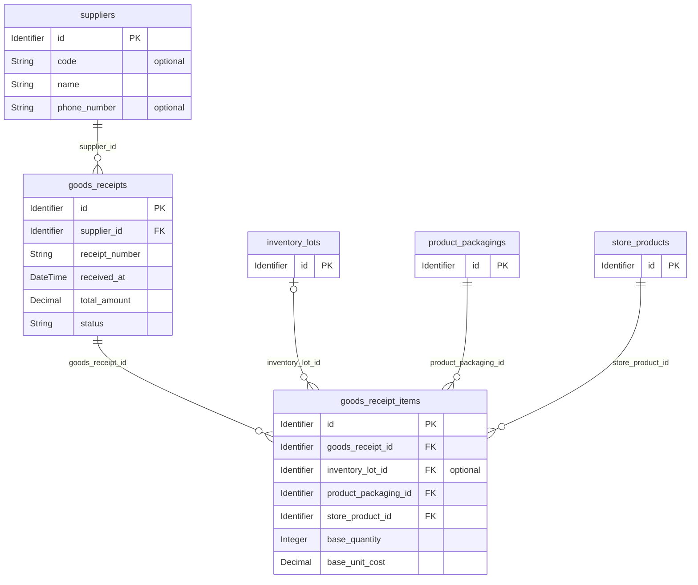

## 5. Tồn kho và đặt giữ hàng

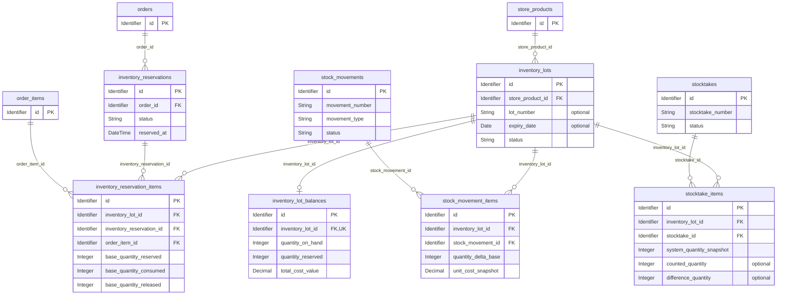

## 6. Giỏ hàng, đơn hàng và thanh toán

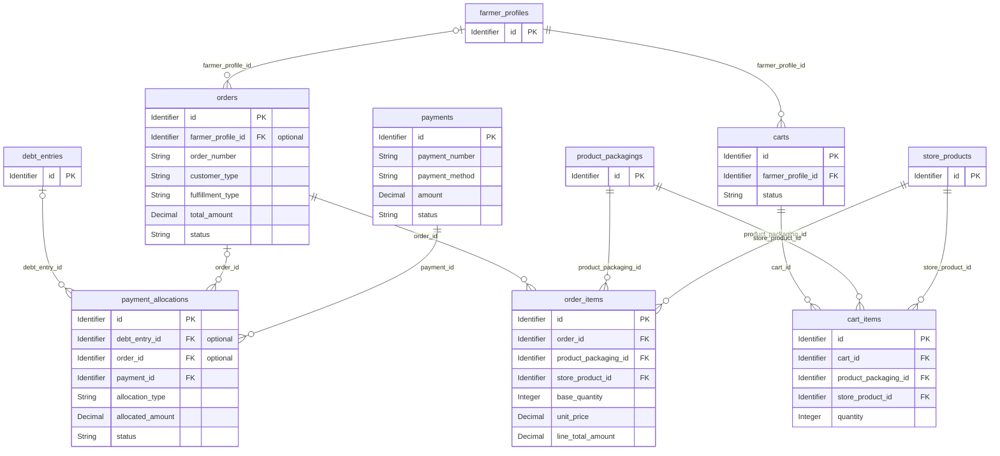

## 7. Giao hàng và truy vết lô

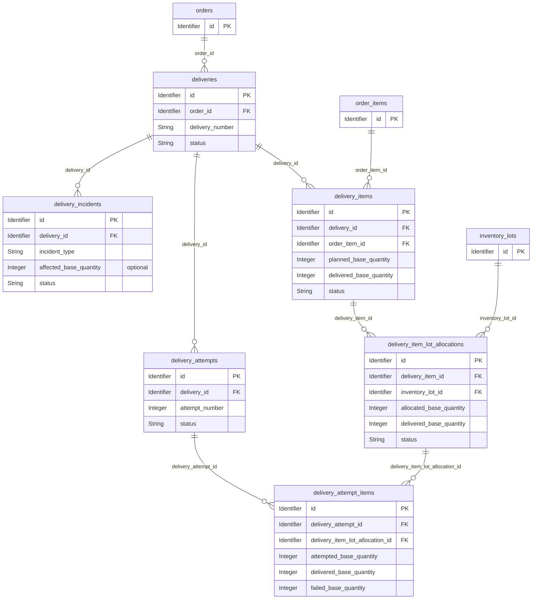

## 8. Tín dụng và công nợ

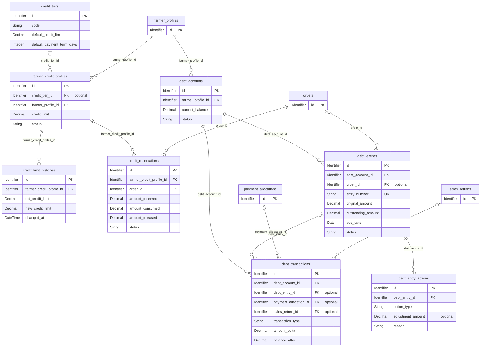

## 9. Trả hàng và hoàn tiền

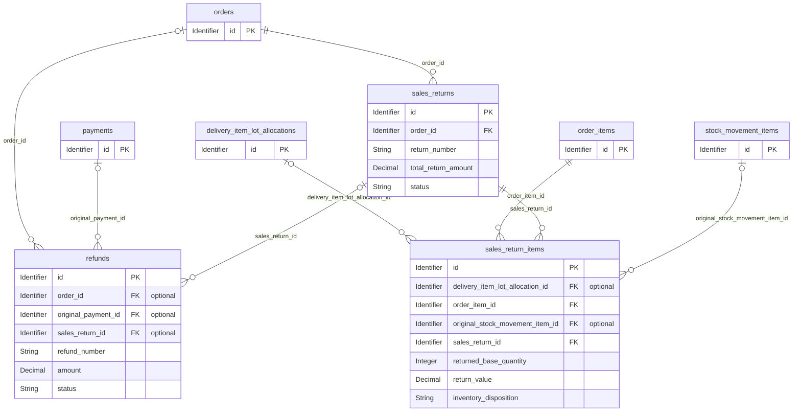

## 10. Chẩn đoán AI và Human Review

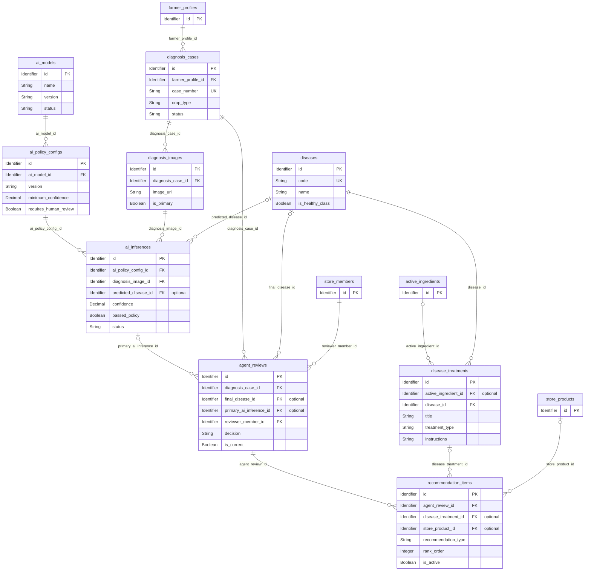

## 11. Nội dung và hệ thống

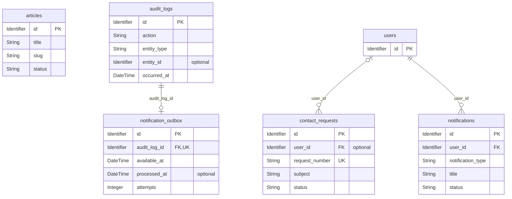

## Đối chiếu và nguồn

- [Danh sách từng quan hệ được lược và lý do](simplified/RELATIONSHIP_REVIEW.md).
- [Bản Mermaid chi tiết trước khi giản lược](agrisage-logical-model-2026-10-26-detailed.mmd).
- [Tài liệu chi tiết trước khi giản lược](MERMAID_LOGICAL_DATA_MODEL_2026-10-26-detailed.md).
- [Thiết kế database](../../reference/DATABASE_DESIGN.md), [mở rộng xác thực](../../reference/AUTH_OPERATIONS_SCHEMA.md), metadata local `model.json` và migration `PermissionOverrideInheritance`.

Đã kiểm tra: giữ đủ 74 thực thể trong 11 nhóm, không nhân đôi thực thể sở hữu, mọi quan hệ được vẽ đều có FK thật trong metadata, bội số và tính optional giữ theo nguồn, các quan hệ đã lược có danh sách đối chiếu. Không truy cập database live.
