# AgriSage - PlantUML State Diagrams

30 standalone diagrams corresponding to the state diagrams discussed in the chat. Inventory/Credit Reservations and Payment Allocation/Debt Transaction are separate diagrams.

Each source includes its own styling: left-to-right layout, rounded white states, thin grey borders, orthogonal connectors, no shadow and no empty description compartment. PlantUML controls exact routing; the result is not guaranteed to match a manually placed drawing pixel for pixel.

Each terminating lifecycle uses one shared final pseudostate within its diagram. Reactivatable administrative objects intentionally have no final node. Composite containers are visual groups, not additional database statuses.

The session and outbox diagrams show derived operational conditions, not stored status enums. Administrative diagrams show representative transitions where the design does not impose a complete graph.

Payment correction: current PayOsPaymentService maps EXPIRED/FAILED provider links to FAILED, and CANCELLED links to CANCELLED. This follows the reference image and current code; the earlier chat description of expiration as CANCELLED was inaccurate.

## 01-user-account - User Account

Source: [puml/01-user-account.puml](puml/01-user-account.puml)

Administrative transitions shown are representative. Application authorization still applies. Status changes invalidate existing sessions.

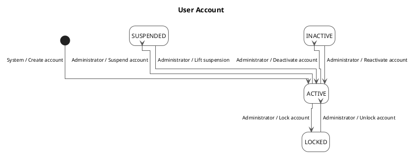

## 02-auth-session - Authentication Session

Source: [puml/02-auth-session.puml](puml/02-auth-session.puml)

These are derived session conditions, not a database status enum. Logging in again creates a new session.

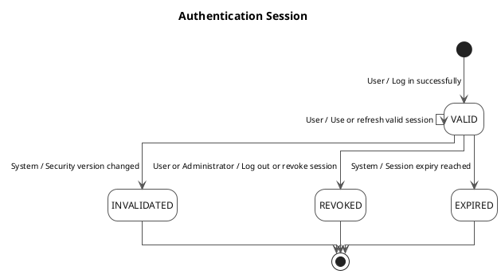

## 03-cart - Shopping Cart

Source: [puml/03-cart.puml](puml/03-cart.puml)

A converted or abandoned cart is not reactivated; further shopping uses a new active cart.

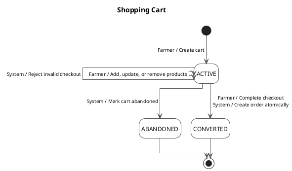

## 04-order - Sales Order

Source: [puml/04-order.puml](puml/04-order.puml)

FULFILLMENT is a visual group, not a stored status. Farmer cancellation is allowed only while PENDING_CONFIRMATION. Payments and refunds remain separate lifecycles.

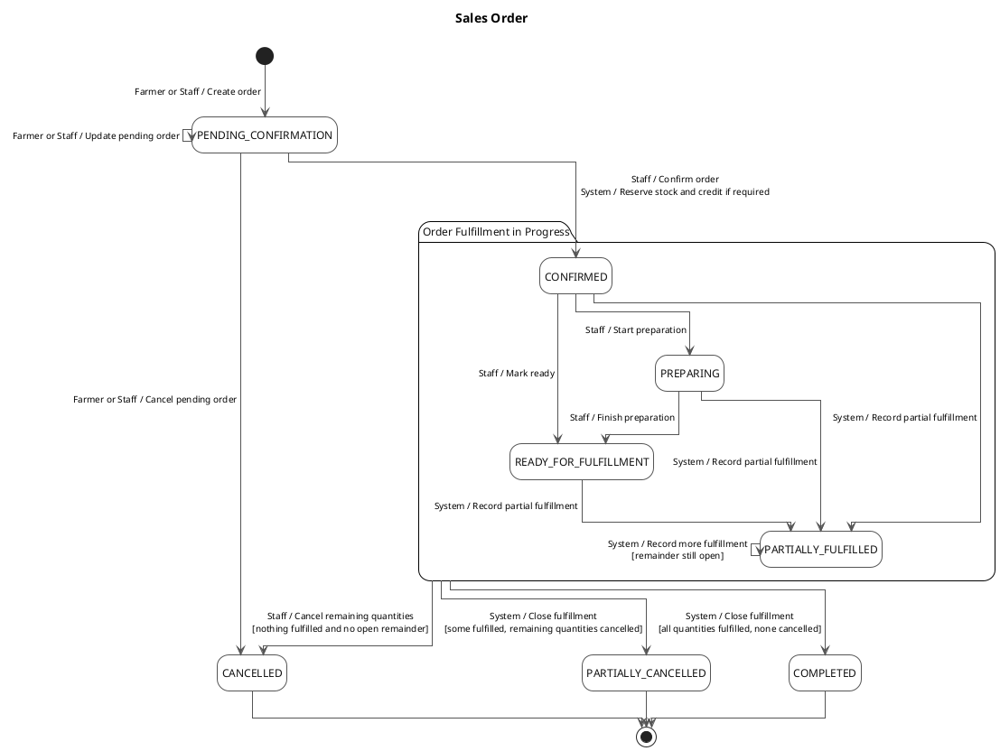

## 05-payment - Payment

Source: [puml/05-payment.puml](puml/05-payment.puml)

Expired payOS links map to FAILED in the current PayOsPaymentService. Invalid or duplicate webhooks do not create a second receipt of money. Retrying a failed or cancelled payment creates a new Payment.

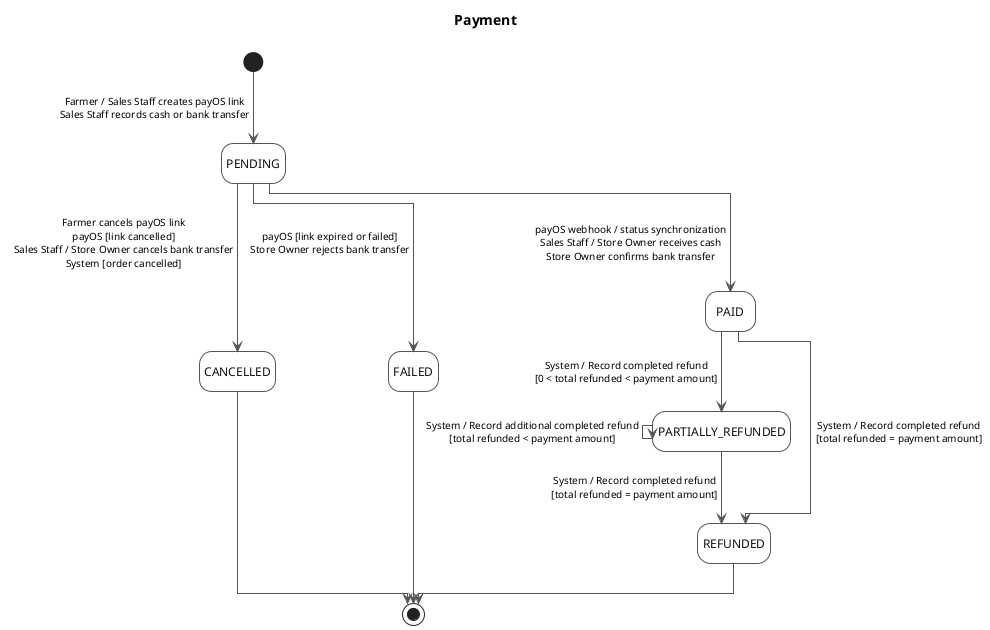

## 06-delivery - Delivery

Source: [puml/06-delivery.puml](puml/06-delivery.puml)

OPEN_DELIVERY is a visual group. Delivery has no PARTIALLY_CANCELLED status: after partial delivery, cancelling the remainder ends the Delivery as DELIVERED; cancelled quantities stay on its items.

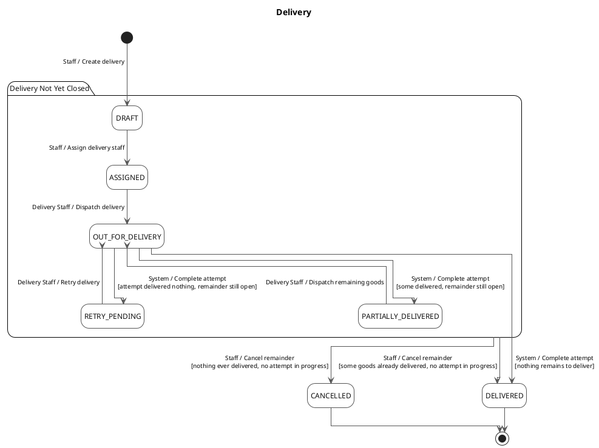

## 07-delivery-attempt - Delivery Attempt

Source: [puml/07-delivery-attempt.puml](puml/07-delivery-attempt.puml)

Only one attempt may be IN_PROGRESS for a Delivery at a time. Another attempt is a new object.

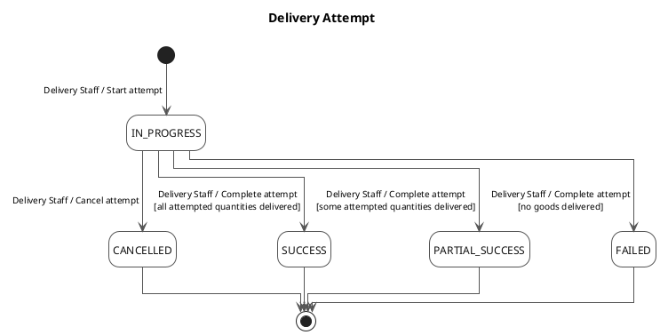

## 08-delivery-incident - Delivery Incident

Source: [puml/08-delivery-incident.puml](puml/08-delivery-incident.puml)

Inventory consequences, when applicable, require an appropriate posted stock movement.

```plantuml
@startuml 08-delivery-incident
!pragma layout elk
left to right direction
hide empty description
skinparam backgroundColor White
skinparam shadowing false
skinparam linetype ortho
skinparam defaultFontName Arial
skinparam defaultFontSize 12
skinparam ArrowColor #555555
skinparam ArrowThickness 1
skinparam ArrowFontName Arial
skinparam ArrowFontSize 10
skinparam nodesep 80
skinparam ranksep 120
skinparam state {
    BackgroundColor White
    BorderColor #555555
    BorderThickness 1
    FontColor #111111
    FontStyle plain
    RoundCorner 14
    StartColor Black
    EndColor Black
}

title Delivery Incident

[*] --> OPEN : Staff / Report incident
OPEN --> OPEN : Staff / Add incident details
OPEN --> RESOLVED : Authorized Staff / Resolve incident\nand record resolution
RESOLVED --> [*]
@enduml
```

## 09-goods-receipt - Goods Receipt

Source: [puml/09-goods-receipt.puml](puml/09-goods-receipt.puml)

Only draft receipts are editable or cancellable. Confirmed receipt corrections require a separate adjustment or reversal operation.

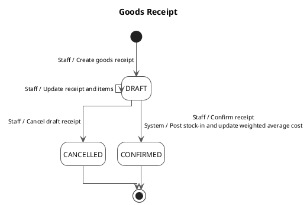

## 10-inventory-lot - Inventory Lot

Source: [puml/10-inventory-lot.puml](puml/10-inventory-lot.puml)

Representative business transitions. DEPLETED is a declared status, not a claim that current stock-posting code changes status automatically at zero stock. Actual expiry date is checked independently; expired, quarantined, blocked or depleted lots cannot be sold/reserved/allocated.

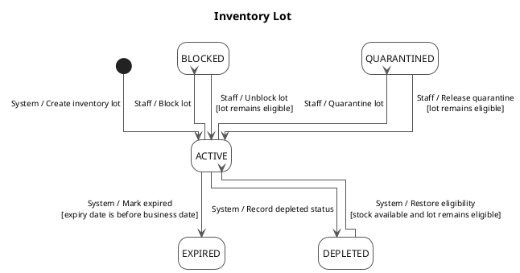

## 11-stock-movement - Stock Movement

Source: [puml/11-stock-movement.puml](puml/11-stock-movement.puml)

STOCK_IN, SALE, RETURN_IN and ADJUSTMENT are movement types, not lifecycle states. POSTED remains eligible for reversal, so it is not connected directly to final.

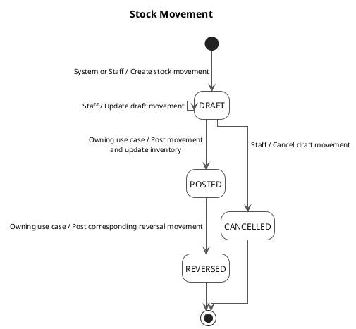

## 12-stocktake - Stocktake

Source: [puml/12-stocktake.puml](puml/12-stocktake.puml)

Completion requires all active items to be counted; stale lines must be handled according to the snapshot rules.

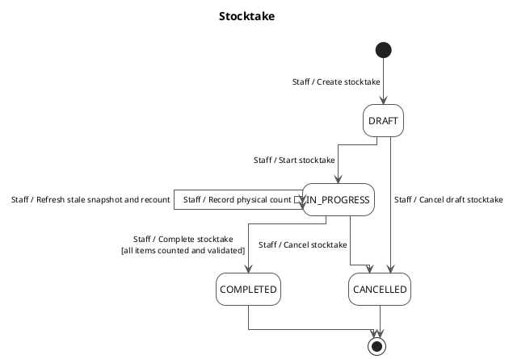

## 13-inventory-reservation - Inventory Reservation

Source: [puml/13-inventory-reservation.puml](puml/13-inventory-reservation.puml)

Statuses are derived from reserved, consumed and released quantities. After any consumption, release the unused remainder instead of cancelling the reservation.

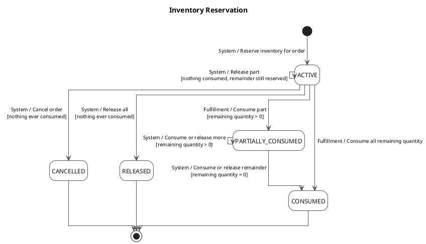

## 14-credit-reservation - Credit Reservation

Source: [puml/14-credit-reservation.puml](puml/14-credit-reservation.puml)

CONSUMED means some amount was consumed and no reservation remains; unused amounts may have been released. Credit exposure includes receivables plus active remaining reservations.

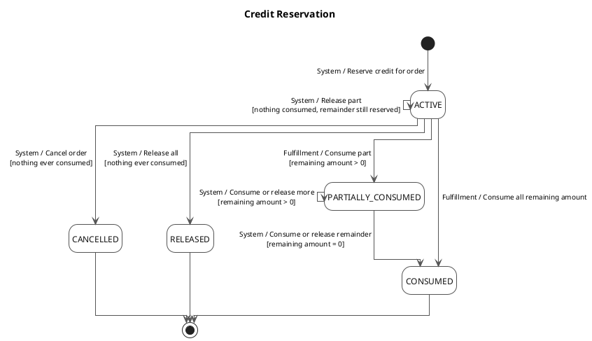

## 15-farmer-credit-profile - Farmer Credit Profile

Source: [puml/15-farmer-credit-profile.puml](puml/15-farmer-credit-profile.puml)

Available credit = credit limit - outstanding receivables - remaining reserved credit. ACTIVE alone is insufficient: customer, debt account and other eligibility rules also apply.

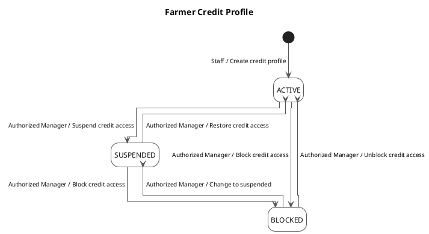

## 16-debt-account - Debt Account

Source: [puml/16-debt-account.puml](puml/16-debt-account.puml)

Administrative status changes are shown. The Domain status setter does not make CLOSED irreversible; authorization and business restrictions belong to the use case.

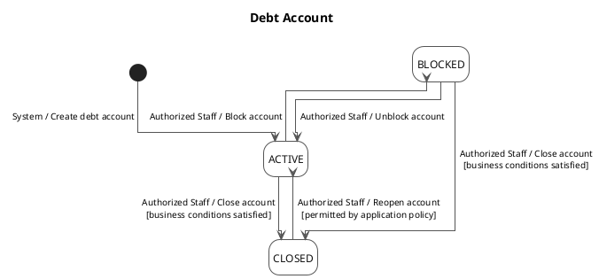

## 17-debt-entry - Debt Entry

Source: [puml/17-debt-entry.puml](puml/17-debt-entry.puml)

OPEN_DEBT is a visual group. A disputed entry may receive payments and stays DISPUTED until resolved. Overdue is derived from due date and balance, not an enum state. Receivable changes require DebtTransactions.

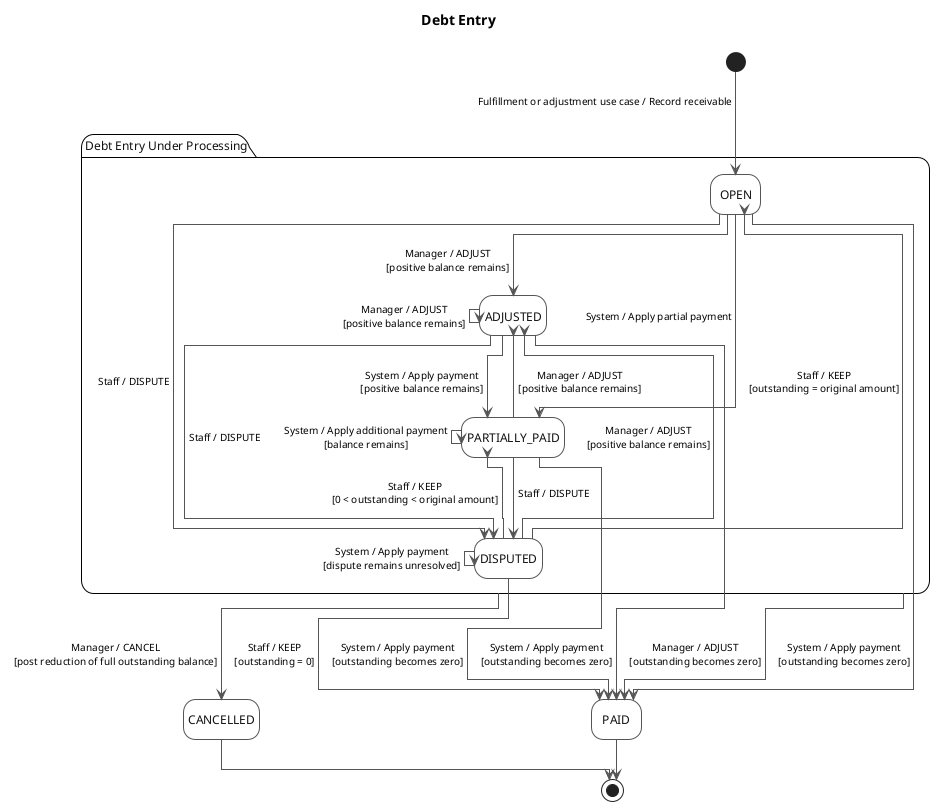

## 18-sales-return - Sales Return

Source: [puml/18-sales-return.puml](puml/18-sales-return.puml)

Only resellable goods may be restocked. Reduce attributable unpaid debt first, then refund the remaining eligible value. Only REQUESTED return items are editable.

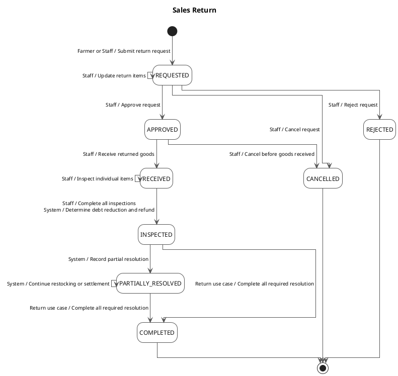

## 19-refund - Refund

Source: [puml/19-refund.puml](puml/19-refund.puml)

Applies to sales-return and cancelled-order refunds. A failed refund is retried with a new Refund, never by reopening the failed object.

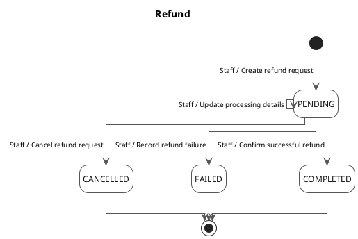

## 20-diagnosis-case - AI Diagnosis Case

Source: [puml/20-diagnosis-case.puml](puml/20-diagnosis-case.puml)

Review requires can_review_ai. VERIFIED and INCONCLUSIVE allow re-review and are not final states. A new review supersedes the previous review and deactivates its recommendations. Recommendations require VERIFIED; Healthy cases receive treatment guidance only, no product recommendation.

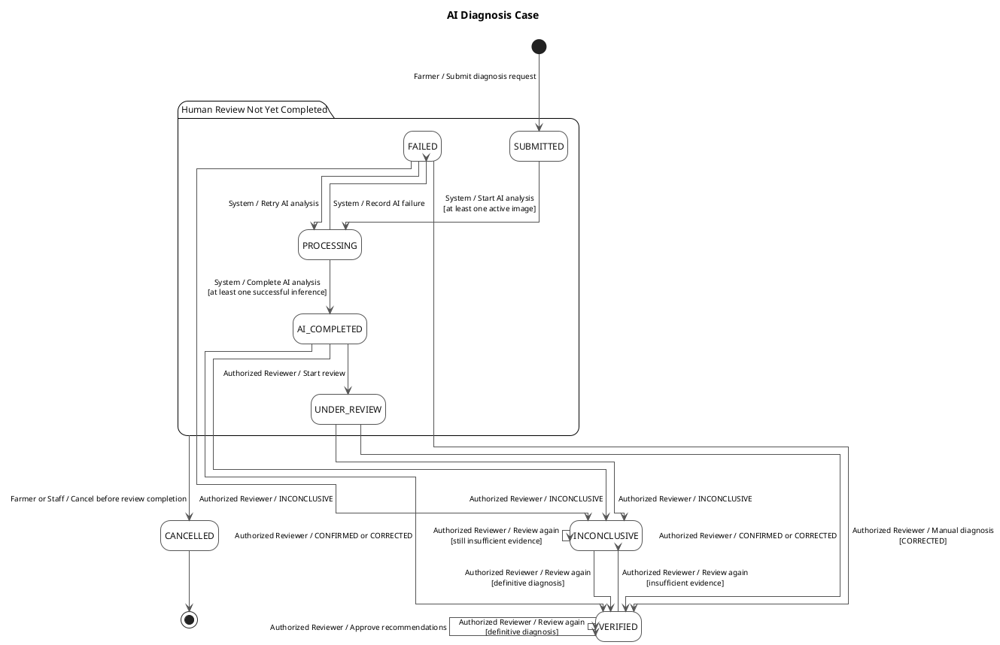

## 21-ai-model - AI Model

Source: [puml/21-ai-model.puml](puml/21-ai-model.puml)

A retired model version is not reactivated by the current Domain lifecycle.

```plantuml
@startuml 21-ai-model
!pragma layout elk
left to right direction
hide empty description
skinparam backgroundColor White
skinparam shadowing false
skinparam linetype ortho
skinparam defaultFontName Arial
skinparam defaultFontSize 12
skinparam ArrowColor #555555
skinparam ArrowThickness 1
skinparam ArrowFontName Arial
skinparam ArrowFontSize 10
skinparam nodesep 80
skinparam ranksep 120
skinparam state {
    BackgroundColor White
    BorderColor #555555
    BorderThickness 1
    FontColor #111111
    FontStyle plain
    RoundCorner 14
    StartColor Black
    EndColor Black
}

title AI Model

[*] --> DRAFT : Authorized Staff / Register model version
DRAFT --> ACTIVE : Authorized Staff / Activate deployment
ACTIVE --> RETIRED : Authorized Staff / Retire model version
RETIRED --> [*]
@enduml
```

## 22-ai-policy-config - AI Policy Config

Source: [puml/22-ai-policy-config.puml](puml/22-ai-policy-config.puml)

Inference requires an active policy of the selected active model, effective at inference time. Policies never bypass mandatory Human Review for recommendations.

```plantuml
@startuml 22-ai-policy-config
!pragma layout elk
left to right direction
hide empty description
skinparam backgroundColor White
skinparam shadowing false
skinparam linetype ortho
skinparam defaultFontName Arial
skinparam defaultFontSize 12
skinparam ArrowColor #555555
skinparam ArrowThickness 1
skinparam ArrowFontName Arial
skinparam ArrowFontSize 10
skinparam nodesep 80
skinparam ranksep 120
skinparam state {
    BackgroundColor White
    BorderColor #555555
    BorderThickness 1
    FontColor #111111
    FontStyle plain
    RoundCorner 14
    StartColor Black
    EndColor Black
}

title AI Policy Config

[*] --> DRAFT : Authorized Staff / Create policy
DRAFT --> ACTIVE : Authorized Staff / Activate policy
ACTIVE --> INACTIVE : Authorized Staff / Deactivate policy
INACTIVE --> ACTIVE : Authorized Staff / Reactivate policy
@enduml
```

## 23-product - Product

Source: [puml/23-product.puml](puml/23-product.puml)

Representative administrative transitions. Product, StoreProduct, packaging, prices and eligible inventory jointly determine sellability. DISCONTINUED is not enforced as an irreversible terminal state by the Domain setter.

```plantuml
@startuml 23-product
!pragma layout elk
left to right direction
hide empty description
skinparam backgroundColor White
skinparam shadowing false
skinparam linetype ortho
skinparam defaultFontName Arial
skinparam defaultFontSize 12
skinparam ArrowColor #555555
skinparam ArrowThickness 1
skinparam ArrowFontName Arial
skinparam ArrowFontSize 10
skinparam nodesep 80
skinparam ranksep 120
skinparam state {
    BackgroundColor White
    BorderColor #555555
    BorderThickness 1
    FontColor #111111
    FontStyle plain
    RoundCorner 14
    StartColor Black
    EndColor Black
}

title Product

[*] --> ACTIVE : Staff / Create active product
ACTIVE --> INACTIVE : Staff / Temporarily stop selling
INACTIVE --> ACTIVE : Staff / Resume selling
ACTIVE --> DISCONTINUED : Staff / Discontinue product
INACTIVE --> DISCONTINUED : Staff / Discontinue product
DISCONTINUED --> ACTIVE : Staff / Restore as active\n[permitted]
DISCONTINUED --> INACTIVE : Staff / Restore as inactive\n[permitted]
@enduml
```

## 24-price-list - Price List

Source: [puml/24-price-list.puml](puml/24-price-list.puml)

Actual price applicability also requires valid effective dates and customer-group assignments.

```plantuml
@startuml 24-price-list
!pragma layout elk
left to right direction
hide empty description
skinparam backgroundColor White
skinparam shadowing false
skinparam linetype ortho
skinparam defaultFontName Arial
skinparam defaultFontSize 12
skinparam ArrowColor #555555
skinparam ArrowThickness 1
skinparam ArrowFontName Arial
skinparam ArrowFontSize 10
skinparam nodesep 80
skinparam ranksep 120
skinparam state {
    BackgroundColor White
    BorderColor #555555
    BorderThickness 1
    FontColor #111111
    FontStyle plain
    RoundCorner 14
    StartColor Black
    EndColor Black
}

title Price List

[*] --> DRAFT : Staff / Create price list
DRAFT --> ACTIVE : Staff / Activate price list
ACTIVE --> INACTIVE : Staff / Deactivate price list
INACTIVE --> ACTIVE : Staff / Reactivate price list
@enduml
```

## 25-article - Article

Source: [puml/25-article.puml](puml/25-article.puml)

The current design allows moving articles to draft, publishing and archiving without imposing an irreversible final state.

```plantuml
@startuml 25-article
!pragma layout elk
left to right direction
hide empty description
skinparam backgroundColor White
skinparam shadowing false
skinparam linetype ortho
skinparam defaultFontName Arial
skinparam defaultFontSize 12
skinparam ArrowColor #555555
skinparam ArrowThickness 1
skinparam ArrowFontName Arial
skinparam ArrowFontSize 10
skinparam nodesep 80
skinparam ranksep 120
skinparam state {
    BackgroundColor White
    BorderColor #555555
    BorderThickness 1
    FontColor #111111
    FontStyle plain
    RoundCorner 14
    StartColor Black
    EndColor Black
}

title Article

[*] --> DRAFT : Staff / Create article
DRAFT --> PUBLISHED : Staff / Publish article
PUBLISHED --> DRAFT : Staff / Move to draft
DRAFT --> ARCHIVED : Staff / Archive article
PUBLISHED --> ARCHIVED : Staff / Archive article
ARCHIVED --> DRAFT : Staff / Restore as draft
ARCHIVED --> PUBLISHED : Staff / Publish again
@enduml
```

## 26-contact-request - Contact Request

Source: [puml/26-contact-request.puml](puml/26-contact-request.puml)

This is the usual handling flow, not an exhaustive transition restriction. The design does not impose a fixed state graph; resolving records resolved_at.

```plantuml
@startuml 26-contact-request
!pragma layout elk
left to right direction
hide empty description
skinparam backgroundColor White
skinparam shadowing false
skinparam linetype ortho
skinparam defaultFontName Arial
skinparam defaultFontSize 12
skinparam ArrowColor #555555
skinparam ArrowThickness 1
skinparam ArrowFontName Arial
skinparam ArrowFontSize 10
skinparam nodesep 80
skinparam ranksep 120
skinparam state {
    BackgroundColor White
    BorderColor #555555
    BorderThickness 1
    FontColor #111111
    FontStyle plain
    RoundCorner 14
    StartColor Black
    EndColor Black
}

title Contact Request

[*] --> OPEN : User / Submit contact request
OPEN --> IN_PROGRESS : Staff / Start processing
OPEN --> RESOLVED : Staff / Resolve directly
OPEN --> CLOSED : Staff / Close request
IN_PROGRESS --> RESOLVED : Staff / Complete resolution
IN_PROGRESS --> CLOSED : Staff / Close request
RESOLVED --> CLOSED : Staff / Close after resolution
CLOSED --> OPEN : Staff / Reopen if permitted
@enduml
```

## 27-notification - Notification

Source: [puml/27-notification.puml](puml/27-notification.puml)

Reading records read_at. Archiving is a semantic lifecycle operation, not physical deletion.

```plantuml
@startuml 27-notification
!pragma layout elk
left to right direction
hide empty description
skinparam backgroundColor White
skinparam shadowing false
skinparam linetype ortho
skinparam defaultFontName Arial
skinparam defaultFontSize 12
skinparam ArrowColor #555555
skinparam ArrowThickness 1
skinparam ArrowFontName Arial
skinparam ArrowFontSize 10
skinparam nodesep 80
skinparam ranksep 120
skinparam state {
    BackgroundColor White
    BorderColor #555555
    BorderThickness 1
    FontColor #111111
    FontStyle plain
    RoundCorner 14
    StartColor Black
    EndColor Black
}

title Notification

[*] --> UNREAD : System / Create notification
UNREAD --> READ : User / Read notification
UNREAD --> ARCHIVED : User / Archive notification
READ --> ARCHIVED : User / Archive notification
ARCHIVED --> [*]
@enduml
```

## 28-notification-outbox - Notification Outbox

Source: [puml/28-notification-outbox.puml](puml/28-notification-outbox.puml)

Operational conditions derived from ProcessedAt, AvailableAt and attempt count, not a stored status enum. Retries use increasing delays.

```plantuml
@startuml 28-notification-outbox
!pragma layout elk
left to right direction
hide empty description
skinparam backgroundColor White
skinparam shadowing false
skinparam linetype ortho
skinparam defaultFontName Arial
skinparam defaultFontSize 12
skinparam ArrowColor #555555
skinparam ArrowThickness 1
skinparam ArrowFontName Arial
skinparam ArrowFontSize 10
skinparam nodesep 80
skinparam ranksep 120
skinparam state {
    BackgroundColor White
    BorderColor #555555
    BorderThickness 1
    FontColor #111111
    FontStyle plain
    RoundCorner 14
    StartColor Black
    EndColor Black
}

title Notification Outbox

[*] --> WAITING : System / Write event to outbox
WAITING --> PROCESSING : Worker / Pick up event\n[available time reached]
PROCESSING --> PROCESSED : Worker / Complete processing
PROCESSING --> RETRY_WAIT : Worker / Record failure\nand increment attempt count
RETRY_WAIT --> PROCESSING : Worker / Retry\n[next available time reached]
PROCESSED --> [*]
@enduml
```

## 29-payment-allocation - Payment Allocation

Source: [puml/29-payment-allocation.puml](puml/29-payment-allocation.puml)

An ORDER allocation cannot be reversed once prepayment has been consumed. ORDER_PAYMENT permits ORDER allocations; DEBT_REPAYMENT permits DEBT allocations.

```plantuml
@startuml 29-payment-allocation
!pragma layout elk
left to right direction
hide empty description
skinparam backgroundColor White
skinparam shadowing false
skinparam linetype ortho
skinparam defaultFontName Arial
skinparam defaultFontSize 12
skinparam ArrowColor #555555
skinparam ArrowThickness 1
skinparam ArrowFontName Arial
skinparam ArrowFontSize 10
skinparam nodesep 80
skinparam ranksep 120
skinparam state {
    BackgroundColor White
    BorderColor #555555
    BorderThickness 1
    FontColor #111111
    FontStyle plain
    RoundCorner 14
    StartColor Black
    EndColor Black
}

title Payment Allocation

[*] --> ACTIVE : System / Allocate funds\n[payment is PAID]
ACTIVE --> ACTIVE : Owning use case / Consume or release prepayment\n[operation is valid]
ACTIVE --> REVERSED : Owning use case / Reverse allocation\n[reversal conditions satisfied]
REVERSED --> [*]
@enduml
```

## 30-debt-transaction - Debt Transaction

Source: [puml/30-debt-transaction.puml](puml/30-debt-transaction.puml)

Posted financial history is preserved; reversal is a semantic operation with corresponding ledger effects, never physical deletion.

```plantuml
@startuml 30-debt-transaction
!pragma layout elk
left to right direction
hide empty description
skinparam backgroundColor White
skinparam shadowing false
skinparam linetype ortho
skinparam defaultFontName Arial
skinparam defaultFontSize 12
skinparam ArrowColor #555555
skinparam ArrowThickness 1
skinparam ArrowFontName Arial
skinparam ArrowFontSize 10
skinparam nodesep 80
skinparam ranksep 120
skinparam state {
    BackgroundColor White
    BorderColor #555555
    BorderThickness 1
    FontColor #111111
    FontStyle plain
    RoundCorner 14
    StartColor Black
    EndColor Black
}

title Debt Transaction

[*] --> POSTED : Owning use case / Post receivable transaction
POSTED --> REVERSED : Owning use case / Reverse transaction\n[corresponding reversal posting recorded]
REVERSED --> [*]
@enduml
```
